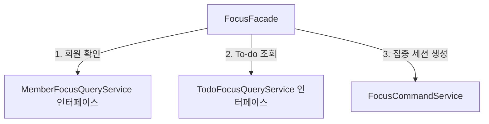

# Code Rules

이 문서는 개발자와 Agent가 함께 따르는 코드 작성·리뷰 규칙의 단일 원본입니다. 요구사항과 API·데이터 계약은 [명세 원본 규칙](specification.md)을 따릅니다.

## 작업 기준

1. 구현 전에 관련 요구사항·기능·API ID와 결정상태를 확인합니다.
2. 기존 코드와 테스트를 읽고 명세 원본 규칙에 따라 확정된 계약을 만족하는 최소 범위만 변경합니다.
3. 명세와 코드가 충돌하거나 기술·업무 결정이 비어 있으면 추정하지 않고 확인합니다.
4. 사용자 변경을 보존하고 요청 밖의 리팩터링과 의존성 추가를 피합니다.

## 기술 스택

| 분류 | 사용 기술 | 비고 |
| --- | --- | --- |
| 언어 | Java 21 | 백엔드 비즈니스 로직을 구현하는 언어다. LTS 버전을 사용해 장기 유지보수와 Spring 기반 기술의 호환성을 확보한다. |
| 프레임워크 | Spring Boot | 인증, DB 접근, 웹 API 등 공통 구성을 자동화한다. 서버 초기 설정 부담을 줄이고 기능 개발에 집중하기 위해 사용한다. |
| 웹 API | Spring MVC | 로그인, To-do, 집중 기록 등의 HTTP 요청과 응답을 처리한다. 컨트롤러와 서비스 로직을 분리해 API를 일관되게 구현한다. |
| 인증·인가 | Spring Security, OAuth2 Client, JWT | Spring Security는 접근 권한을 제어하고, OAuth2 Client는 Google·Kakao 소셜 인증을 연동한다. JWT는 로그인 이후 API 요청의 인증에 사용하며 만료·갱신·로그아웃 정책을 함께 설계해야 한다. |
| ORM | Spring Data JPA, Hibernate | 계정, To-do, 집중 세션, 회고 등의 데이터를 객체 중심으로 조회·저장한다. 반복적인 CRUD 구현을 줄이며, 통계 조회는 쿼리 성능과 N+1 문제를 별도로 관리한다. |
| 데이터베이스 | MySQL | 계정·학습 기록 등 영구 데이터를 저장하고 트랜잭션과 제약조건으로 정합성을 유지한다. |
| 캐시·임시 상태 | Redis | 자주 조회하는 데이터의 캐시와 만료가 필요한 임시 상태를 관리한다. 인증 토큰 관리나 접속 상태 등에 활용할 수 있으며, 영구 학습 기록의 원본은 관계형 DB에 유지한다. |
| 실시간 통신 | Spring WebSocket, STOMP | 집중방의 참여자·집중 상태 변화를 실시간으로 전달한다. WebSocket은 지속 연결을 제공하고 STOMP는 방별 구독·메시지 전달 규칙을 구성한다. 집중방 기능 도입 시 필요하다. |
| 서버 간 실시간 전파 | RabbitMQ | 서버가 여러 대일 때 다른 서버에 연결된 사용자에게도 집중방 이벤트를 전달하기 위해 사용한다. 단일 서버 단계에서는 필수성이 낮으며, 서버 확장 시 STOMP 브로커 연동 방식과 메시지 전달 정책을 결정한다. |
| 동시성 제어 | Redisson 기반 Redis 분산 락 | 여러 서버에서 같은 집중방의 입장·인원 변경 등을 동시에 처리할 때 경합을 제어한다. 실제 경쟁 조건이 있는 작업에 한해 적용하며, DB 트랜잭션·제약조건을 대체하지 않는다. |
| 예약 | Spring Scheduler | 만료 상태 정리나 정기 집계처럼 일정 주기로 실행할 작업에 사용한다. 여러 서버에서 실행할 경우 같은 작업이 중복 수행되지 않도록 실행 주체나 락 정책을 정해야 한다. |
| 파일 저장 | Google Cloud Storage | 프로필 이미지 등 업로드 파일을 서버 로컬 디스크와 분리해 저장한다. 서버 교체·확장 시에도 파일을 유지할 수 있으며 파일 접근 권한, 크기·형식 검증, 삭제 정책이 필요하다. |
| DB 마이그레이션 | Flyway | DB 테이블·인덱스 변경을 버전별 스크립트로 관리한다. 개발·테스트·운영 환경에 동일한 스키마 변경을 적용하고 변경 이력을 추적하기 위해 사용한다. |
| API 문서 | OpenAPI, Scalar API Reference | OpenAPI로 요청·응답·인증 규격을 정의하고 Scalar로 문서를 탐색·테스트한다. 프론트와 백엔드가 동일한 API 계약을 확인하도록 하며 실제 구현과 문서의 일치를 관리한다. |
| 테스트 | JUnit 5, Mockito, AssertJ, Testcontainers | JUnit 5는 테스트 실행, Mockito는 의존성 모킹, AssertJ는 결과 검증에 사용한다. Testcontainers는 DB·Redis 등의 통합 테스트 환경을 구성하여 인증·세션·기록 저장 로직의 회귀 오류를 줄인다. |
| 모니터링 | Spring Boot Actuator, Micrometer, Prometheus, Grafana | Actuator로 서버 상태를 노출하고 Micrometer로 지표를 계측한다. Prometheus가 지표를 수집하고 Grafana가 시각화하여 응답 지연·오류율·자원 사용량 등을 확인한다. 관리용 엔드포인트는 접근을 제한한다. |
| 로깅 | Logback, Grafana Loki | Logback으로 애플리케이션 로그를 기록하고 Loki로 여러 서버의 로그를 모아 조회한다. 장애 원인을 추적하기 위해 사용하며 토큰·개인정보가 로그에 남지 않도록 관리한다. |
| 빌드 도구 | Gradle | 의존성 관리, 컴파일, 테스트, 패키징을 자동화한다. 멀티 모듈 프로젝트의 빌드 규칙을 통일하고 로컬·CI에서 동일한 빌드 절차를 실행한다. |
| 컨테이너 | Docker | 애플리케이션 실행 환경을 이미지로 고정한다. 개발·테스트·배포 환경 차이를 줄이고 동일한 이미지로 서버를 재배포하기 위해 사용한다. |
| CI/CD | GitHub Actions | 코드 변경 시 테스트·품질 검사·빌드·배포 절차를 자동 실행한다. 수동 작업과 배포 실수를 줄이며 운영 배포 승인과 비밀값 관리 정책을 함께 구성한다. |
| 배포 환경 | GCP — Google Cloud Compute Engine, Google Cloud SQL | 배포 플랫폼은 GCP로 결정했다. 서버 실행과 파일 저장 등 필요한 인프라를 같은 클라우드 환경에서 구성·관리하기 위해 사용한다. Compute Engine은 애플리케이션 서버 실행에, Cloud Storage는 업로드 파일 저장에 활용한다. Cloud SQL for MySQL을 사용하여 백업, 복구, 패치 등 DB 운영 부담을 줄이고 안정적인 관리형 관계형 DB 환경을 구성한다. GCP 내 세부 DB 배포 구성은 추가 확인이 필요하다. |
| 아키텍처 | 멀티 모듈 계층형 | 웹 요청 처리, 비즈니스 로직, 데이터 접근 등의 책임과 의존성을 분리한다. 기능 확장과 테스트를 쉽게 하되 초기에는 불필요한 모듈 분할을 피한다. |
| API 방식 | REST API | 계정·To-do·집중 기록 등의 리소스를 HTTP 메서드와 상태 코드로 다룬다. 웹·모바일에서 공통 API를 사용하도록 하며 실시간 집중방 이벤트는 WebSocket으로 분리한다. |
| 통신 보안 | HTTPS, TLS | 로그인 토큰과 사용자 데이터가 전송되는 구간을 암호화한다. 통신 내용의 도청·변조 위험을 줄이기 위해 필요하며 인증서 갱신과 보안 설정을 관리한다. |
| 코드 품질 | JaCoCo, Spotless, SpotBugs, Checkstyle, ArchUnit | JaCoCo는 테스트 커버리지 측정, Spotless는 코드 포맷 통일, SpotBugs는 잠재적 버그 탐지에 사용한다. Checkstyle은 네이밍·Javadoc 등 코드 작성 규칙을 검사하고, ArchUnit은 계층·모듈 의존 방향과 순환 의존 등 아키텍처 규칙을 검증한다. CI에 연결하여 품질 기준을 자동 검사하되 커버리지 수치만으로 테스트 품질을 판단하지 않는다. |

## 모듈과 패키지

모듈별 코드 배치는 다음 기준을 따릅니다.

| 위치 | 배치할 코드 |
| --- | --- |
| `apps` | 애플리케이션 실행 구성, Controller, HTTP DTO, UseCase Service, 업무 모델·정책, 트랜잭션, JPA 엔티티·저장 구현 |
| `integrations` | GCS, Redis·Redisson, RabbitMQ 등 외부 시스템 연동 코드 |
| `infra` | Docker, GCP, 모니터링 등 배포·운영 설정과 스크립트. Gradle 모듈이 아님 |

초기에는 `apps:api`에 기능별 업무 코드를 모읍니다. `apps`, `integrations`는 분류용 디렉터리이며, 그 아래 실행 앱과 연동 라이브러리가 실제 Gradle 모듈입니다. `integrations:storage`, `integrations:redis`, `integrations:messaging`에는 모듈 경계와 SDK 의존성을 구성했으며, 실제 연결 설정과 구현은 기능 도입 시 추가합니다.

```text
backend/
├─ apps/
│  └─ api/                 # HTTP API·WebSocket 서버
├─ integrations/
│  ├─ storage/             # GCS 연동
│  ├─ redis/               # Redis·Redisson 연동
│  └─ messaging/           # RabbitMQ 연동 모듈, 구현은 도입 시 추가
├─ infra/
│  ├─ docker/              # Dockerfile·Compose
│  ├─ monitoring/          # Prometheus·Grafana·Loki 설정
│  └─ gcp/                 # GCP 인프라·배포 설정
└─ .github/
   └─ workflows/           # GitHub Actions
```

- Security·OAuth2 로그인 구성, WebSocket·STOMP 진입점과 권한 처리는 `apps:api`에 둡니다.
- 캐시 키·TTL, 분산 락의 적용 범위, 메시지 발행 시점 등 업무별 정책은 실행 앱의 관련 기능에서 결정합니다. `integrations`는 연결·직렬화·외부 호출 등 기술 연동을 담당합니다.
- Spring 기본 `application.yaml`, DB 연결 설정과 Flyway 마이그레이션은 실행 앱에서 관리합니다. 배포 환경별 값은 실행 시 주입하며, `infra`에는 배포 설정과 환경변수 예시를 두고 실제 비밀값을 저장하지 않습니다.
- 단순 예약 작업은 `apps:api`의 관련 기능에서 Spring Scheduler로 실행합니다. 독립적인 실행·배포가 필요해지면 `apps:batch`를 추가합니다.
- API와 배치가 공유할 업무 모델·정책·저장 계약이 생기면 필요한 부분만 `domains` 모듈로 추출합니다. 이때 JPA 매핑과 저장 구현의 소유 위치도 함께 정하며, 공유가 필요해지기 전에는 `domains`를 만들지 않습니다.

업무 코드는 Aggregate Root(함께 저장하고 일관성을 지키는 업무 단위)와 책임을 기준으로 나눕니다. 아래는 패키지 이름 예시이며, 모든 패키지를 미리 만들지는 않습니다.

```text
<기본 패키지> (apps:api)
├─ member
│  ├─ controller
│  ├─ service
│  │  ├─ command
│  │  └─ model
│  ├─ repository
│  ├─ entity
│  ├─ dto
│  │  ├─ request
│  │  └─ response
│  └─ exception
├─ todo
├─ focus
├─ retrospective
├─ room
└─ common
   ├─ config
   ├─ client
   └─ exception
```

- `controller`: HTTP Controller
- `service`: UseCase Service와 Facade
- `repository`: Aggregate Root의 저장·조회 계약과 Adapter
- `entity`: Aggregate Root, Entity와 Value Object
- `dto`: HTTP 요청·응답 모델
- `client`: 외부 API, 메시징과 외부 시스템 연계
- `common`: 실제로 여러 Aggregate가 공유하는 기술 요소

`todo`, `focus`, `retrospective`, `room`도 `member`처럼 기능 안에서 책임별로 나눕니다. 기본 패키지명은 `com.tomo`입니다. `client`에는 연동 모듈과 업무 흐름을 연결하는 코드가 필요한 경우에만 두고, 외부 SDK 호출 구현은 `integrations`에 둡니다.

Controller·Service·Repository를 전역 패키지에 모으지 않습니다.

초기에는 JPA 엔티티와 Repository를 실행 앱의 해당 기능에 둡니다. 향후 공유 업무 모듈을 추출할 때 저장 계약과 구현을 분리할 수 있습니다.

## 의존성과 업무 경계

### 기본 의존 방향

- 초기 모듈 의존은 `apps:api → integrations:*` 방향입니다. 연동 모듈은 실행 앱이나 다른 업무 기능의 구현을 참조하지 않습니다.
- `infra`는 배포·운영 설정 디렉터리로 Java 모듈 의존 관계에 포함하지 않습니다.
- 연동 모듈에는 실행 앱의 Entity·HTTP DTO를 전달하지 않습니다. 실행 앱에서 연동 모듈이 정의한 입력·결과 타입으로 변환합니다.
- Controller는 입력 검증과 응답 변환을 담당합니다.
- 업무 판단은 Service와 Entity에 둡니다.
- Service와 Entity는 HTTP 요청·응답 DTO에 의존하지 않습니다.
- 업무 계약을 두는 경우 실행 앱의 Adapter가 연동 모듈을 호출해 해당 계약을 구현합니다. 이 계약을 구현하려고 연동 모듈이 실행 앱에 의존하지 않습니다.
- 향후 배치 앱을 추가해도 실행 앱끼리 직접 의존하지 않습니다. 공유 업무 모듈을 추출하면 `apps → domains`, 필요한 경우 `integrations → domains` 방향으로 구성합니다.
- 추출한 `domains` 모듈은 Web, DB, 메시징, 외부 통신 SDK에 의존하지 않으며, 저장·조회 계약에 Spring Data·JPA 타입을 노출하지 않습니다.

### Service와 전달 모델

| 구분 | 이름 | 역할 |
|---|---|---|
| 처리 | `QueryService` | 상태를 변경하지 않고 조회 |
| 처리 | `CommandService` | 생성·수정·삭제 수행 |
| 조정 | `Facade` | 여러 Service를 조정해 하나의 기능 제공 |
| 입력 | `service.command` | 업무 실행에 필요한 값. 예: `CreateTodoCommand` |
| 결과 | `service.model` | 업무 결과나 공개 조회 값. 예: `TodoResult`, `MemberSummary` |

조회와 변경이 단순하면 하나의 `Service`에서 처리합니다. 책임이 복잡해질 때 `QueryService`와 `CommandService`로 나눕니다.

### Aggregate 간 접근

- 각 Aggregate는 자신의 Repository만 사용합니다.
- 다른 Aggregate의 Entity·Repository·HTTP DTO를 직접 참조하지 않습니다.
- 다른 Aggregate의 정보는 해당 `QueryService`를 통해 조회합니다.
- 다른 도메인의 서비스를 호출할 때는 해당 도메인이 공개한 서비스 인터페이스에 의존합니다. 구현 클래스를 직접 주입하거나 참조하지 않습니다.
- 공개 인터페이스는 기능을 제공하는 도메인의 `service` 패키지에 두고, 제공 도메인의 Service가 구현합니다. 인터페이스에는 호출 측에 필요한 기능만 공개하며 용도를 드러내는 이름을 사용합니다. 예: `TodoFocusQueryService`.
- 도메인 간 호출의 입력은 Command 또는 필요한 값으로, 결과는 불변 Model로 전달합니다. 인터페이스에 Entity·Repository·HTTP DTO를 노출하지 않습니다.
- 조회 결과는 필요한 값만 담은 불변 모델로 전달합니다.
- Entity에는 다른 Aggregate 객체 대신 식별자를 보관합니다.

### 여러 Aggregate의 조정

하나의 Aggregate에서 끝나는 기능은 해당 Service가 처리합니다. 여러 Aggregate를 함께 사용하는 기능은 **대표 Aggregate의 Facade**가 조정합니다.

Facade는 각 Service를 호출하며, Repository를 직접 사용하지 않습니다.

아래는 To-do에 연결된 집중 세션을 시작한다고 가정한 구조 예시입니다. 집중 기능의 Facade가 회원과 To-do를 확인한 뒤 집중 세션 생성을 요청합니다. 다른 도메인인 회원·To-do는 공개 조회 인터페이스를 통해 접근하고, 같은 집중 도메인의 `FocusCommandService`는 구체 클래스로 호출합니다. 실제 필수 입력, 접근 권한과 세션 시작 조건은 명세 원본 규칙에 따라 확정된 TOMO 명세를 따릅니다.



예시에서 `MemberQueryService`는 `MemberFocusQueryService`를, `TodoQueryService`는 `TodoFocusQueryService`를 구현합니다. `FocusFacade`는 두 구현 클래스를 직접 참조하지 않습니다. 인터페이스 이름과 메서드는 실제로 필요한 계약에 맞춰 정의합니다.

즉시 완료할 필요가 없는 후속 처리는 도메인 이벤트를 검토하고, 재시도와 실패 처리도 함께 결정합니다.

### 불필요한 복잡성 방지

- 순환 의존이 생기면 책임과 의존 방향을 재검토합니다.
- `@Lazy`, Setter 주입, 순환 참조 허용 설정으로 순환 의존을 숨기지 않습니다.
- 실제로 필요해지기 전에는 추상화, 계층, 공유 유틸리티를 추가하지 않습니다.

## 트랜잭션과 외부 연동

### 트랜잭션 경계

- 상태 변경 트랜잭션은 Service 또는 Facade의 `public` 업무 메서드에 둡니다.
- 여러 변경을 함께 성공·실패시켜야 한다면 이를 조정하는 메서드를 트랜잭션 경계로 정합니다.
- DB 조회용 트랜잭션은 `readOnly = true`로 표시합니다. 이는 쓰기 차단을 보장하는 장치가 아니라 트랜잭션 시스템에 전달하는 힌트입니다.
- Controller와 DTO에는 트랜잭션을 두지 않습니다.
- 기본 Spring 프록시 방식에서는 같은 객체 내부 호출이나 `private` 메서드의 `@Transactional`에 의존하지 않습니다.

### 외부 호출

- 외부 네트워크 호출은 원칙적으로 DB 트랜잭션 밖에서 수행합니다.
- 외부 호출에는 타임아웃을 설정합니다.
- 재시도는 대상 오류, 횟수, 간격과 중복 실행의 안전성을 함께 결정합니다.
- 외부 작업과 DB 변경의 일관성이 필요하면 멱등성, 보상 처리 또는 Outbox 등 필요한 방식을 선택합니다.

외부 호출 결과를 저장할 때는 호출하는 상위 흐름에도 DB 트랜잭션이 없는지 확인합니다.

```java
// 이 코드를 실행하는 상위 흐름에도 DB 트랜잭션이 없어야 합니다.
StoredFile storedFile = storageClient.upload(uploadInput);

// 별도 Spring Bean의 public @Transactional 메서드를 호출합니다.
memberCommandService.updateProfileImage(memberId, storedFile.objectKey());
```

위 코드는 GCS에 파일을 업로드한 뒤 회원의 프로필 이미지 참조를 저장한다고 가정한 흐름 예시입니다. 실제 타입과 정책은 구현 시 정합니다. 업로드 성공 후 DB 저장이 실패하면 파일이 남을 수 있으므로 보상 삭제나 미참조 파일 정리 등 실패 처리도 함께 설계합니다.

## Java 작성 규칙

### 이름

- 기본 이름은 `{Aggregate}Controller`, `{Aggregate}Service`, `{Aggregate}Repository`입니다.
- 책임을 나눌 때는 `QueryService`, `CommandService`, `Facade`처럼 역할을 붙입니다.
- 값이 없을 수 있는 조회는 `find...`, 반드시 존재해야 하는 조회는 `get...`으로 표현합니다.
- 존재 여부는 `exists...`, 개수는 `count...`로 표현합니다.
- Boolean은 `is...`, `has...`, `can...`처럼 의미를 드러냅니다.
- Java 약어는 `ApiClient`, `UrlParser`처럼 일반 단어로 표기합니다.
- `data`, `info`처럼 대상이 드러나지 않는 이름을 피하고 `memberSummary`, `todoRequest`처럼 의미를 드러냅니다.

### 구현 방식

- 같은 도메인 내부의 Service와 Facade는 기본적으로 구체 클래스로 사용합니다. 다른 도메인에 공개하는 서비스 계약은 인터페이스로 정의하며, 구현 교체나 모듈 경계 분리가 필요한 경우에도 인터페이스를 도입할 수 있습니다.
- `Service`와 `ServiceImpl`을 기계적으로 분리하지 않습니다.
- Spring Bean은 생성자 주입을 사용합니다.
- 업무 의미가 있는 리터럴은 이름 있는 상수나 타입으로 표현합니다.

### 주석과 Javadoc

주석은 코드 동작을 반복하지 않고 제약과 선택 이유를 기록합니다. Checkstyle 검사 대상인 운영 코드의 `public` 타입·메서드·생성자에는 Javadoc을 작성합니다.

- 호출 조건, 보장 결과, 부수 효과를 필요한 만큼 설명합니다.
- 검사 대상의 매개변수와 반환값은 `@param`·`@return`에 짧게 설명하고, 형식·단위·범위가 있으면 함께 적습니다.
- `@throws`는 발생 조건을 설명합니다. 호출자가 알아야 할 전파 예외를 기록하며, Checkstyle은 `validateThrows = true`로 검사합니다.
- 테스트 클래스와 테스트 메서드에는 Javadoc을 작성하지 않습니다. 테스트 설명과 주석은 아래 테스트 규칙을 따릅니다.
- 비공개 구현, 의미가 명확한 Getter·Setter와 계약을 그대로 따르는 `@Override`는 Javadoc을 생략할 수 있습니다. 검사 범위는 [Checkstyle 설정](../../config/checkstyle/checkstyle.xml)과 [테스트 Javadoc 제외 설정](../../config/checkstyle/suppressions.xml)을 따릅니다.
- 작성자·작성일·변경 이력, 미확정 규칙과 검사 통과용 문구를 적지 않습니다.

### 포맷

- 포맷과 import는 Spotless의 Google Java Format을 따릅니다.

## API, DTO와 예외

### API 계약과 입력 검증

- API 경로, 요청·응답, 상태 코드와 오류 형식은 명세 원본 규칙에 따라 확정된 명세를 따릅니다.
- 입력 형식·필수 값·범위·필드 간 조건은 Controller 경계에서 검증합니다.
- 권한, 중복, 상태 전이처럼 업무 데이터가 필요한 판단은 Service와 Entity에서 수행합니다.
- 상태 변경 API는 중복 요청 처리와 멱등성 기준을 결정합니다.
- 목록 API는 페이지·정렬 기준을 결정합니다.
- 공개 계약을 깨는 변경에는 버전 또는 호환 전략이 필요합니다.

### DTO 변환

DTO는 경계의 데이터 전달과 단순 변환만 담당합니다. 입력·결과 타입의 위치는 앞 절의 Service와 전달 모델 기준을 따릅니다.

- Request DTO는 입력 검증과 Command로의 필드 변환만 수행합니다. 입력이 단순하면 Command 없이 개별 값으로 전달해도 됩니다.
- Request의 변환은 `toCommand()`, Response의 정적 팩터리는 `from(result)`로 표현합니다.
- Response에서 Entity를 생성하지 않습니다.
- DTO에서 Repository·Service·외부 API를 호출하거나 권한·중복·상태 전이를 판단하지 않습니다.
- 불변 모델이 컬렉션을 받으면 방어적 복사로 후속 변경을 막습니다. 컬렉션 요소도 불변인지 확인합니다.
- Service는 업무 결과를 조합하고, Controller 또는 웹 Assembler가 HTTP Response로 변환합니다.
- 자동 매핑 라이브러리는 이점이 확인될 때만 도입합니다.

### 예외 처리

- 업무 예외는 Aggregate별 `exception` 패키지에 두고 공통 `BusinessException`과 안정적인 `ErrorCode`로 구분합니다.
- `ErrorCode`는 Spring의 `HttpStatus`에 의존하지 않습니다. `@RestControllerAdvice`가 API 계약에서 확정한 HTTP 상태와 오류 응답으로 변환합니다.
- 업무 오류 메시지는 외부 공개용으로 정의한 것만 반환합니다.
- Repository·외부 SDK의 기술 예외, 내부 메시지, SQL과 Stack Trace를 HTTP 응답에 노출하지 않습니다.
- 예상하지 못한 예외는 추적 ID로 서버 로그와 연결합니다.
- 같은 예외를 여러 계층에서 반복해서 기록하지 않습니다.
- HTTP 밖의 Batch·비동기 실행 경계는 별도의 실패 처리와 관측 규칙을 둡니다.


## 데이터베이스

### 엔티티 연관관계

- 연관관계는 실제 업무 흐름에서 필요한 객체 탐색 방향을 기준으로 설계하며, 기본은 단방향으로 둡니다. 한쪽에서만 상대 엔티티를 조회하면 역방향 연관관계를 추가하지 않습니다.
- 같은 Aggregate 안에서 양쪽 객체를 통해 서로 탐색해야 하는 요구가 있으면 양방향 연관관계를 허용합니다. 다른 Aggregate는 앞 절의 Aggregate 간 접근 기준에 따라 식별자로 참조합니다.
- 단건·목록 조회 여부나 조회 데이터의 양만으로 단방향·양방향을 결정하지 않습니다. 여러 데이터를 함께 가져와야 하는 경우에는 조회 쿼리, fetch join, EntityGraph 또는 DTO 조회 등 적절한 조회 방식을 선택합니다.
- 외래 키를 매핑하는 연관관계의 주인에 `@JoinColumn`을 두고, 양방향 관계의 반대편은 `mappedBy`로 연결합니다. 양방향 탐색을 위해 같은 외래 키를 중복 매핑하지 않습니다.
- 양방향 관계를 사용하면 연관관계 편의 메서드로 양쪽 객체의 상태를 함께 관리합니다. 조회 편의를 위해 불필요한 컬렉션을 추가하거나 EAGER 로딩으로 일괄 해결하지 않습니다.

### 스키마와 데이터 관리

- 스키마 변경은 Flyway Migration으로 재현 가능하게 관리합니다.
- 참조 무결성, 삭제 동작, 시간대와 시간 정밀도를 명시합니다.
- 생성·수정 시각과 처리자 등 감사 정보의 필요 여부와 기록 주체를 결정합니다.
- N:M 관계는 관계 테이블로 표현합니다. 관계 자체에 업무 의미와 독립적인 생명주기가 있다면 일관성 경계를 검토하여 별도 Aggregate 여부를 결정합니다.
- 인덱스는 실제 조회·정렬 근거로 추가합니다.
- Soft Delete는 복구·감사 요구가 있을 때만 사용합니다.
- 데이터 손실 가능성이 있는 Migration에는 사전 검증과 복구 계획이 필요합니다.
- ORM Entity를 API 계약으로 노출하거나 Aggregate 외부에서 내부 Entity를 개별 저장하지 않습니다.
- PK 방식과 세부 명명 규칙은 데이터 명세가 결정하기 전까지 확정하지 않습니다.

## 테스트

- 테스트 하나는 하나의 관찰 가능한 행위나 업무 규칙을 검증합니다.
- 테스트 클래스와 테스트 메서드에는 Javadoc을 작성하지 않습니다.
- 테스트 메서드에 `@DisplayName`을 사용하고, 어떤 조건에서 어떤 동작·결과를 검증하는지 한국어로 작성합니다. 예: `@DisplayName("완료한 To-do는 다시 완료 처리할 수 없다")`. 예시는 설명 형식이며 실제 검증 내용은 명세 원본 규칙에 따라 확정된 명세를 따릅니다.
- 테스트 본문의 주석은 준비·실행·검증을 구분하는 `// given`, `// when`, `// then`만 사용합니다. 순서는 given → when → then으로 작성하고, 준비가 필요 없는 경우처럼 해당 단계가 없으면 그 주석은 생략합니다.
- 기능에 해당하는 정상 흐름, 경계값, 실패, 권한 거부와 중복 요청을 검증합니다.
- 버그 수정에는 가능하면 회귀 테스트를 추가합니다.
- 시간·식별자 생성·외부 호출이 테스트 결과에 영향을 주면 테스트에서 제어할 수 있게 분리합니다.
- Mock은 외부 경계를 격리하는 데 사용하며 내부 호출 순서를 과도하게 고정하지 않습니다.
- DB, 직렬화와 외부 Adapter 계약은 필요한 수준의 통합 테스트로 확인합니다.
- 예외 테스트는 가능한 경우 타입과 `ErrorCode`를 함께 검증합니다.
- 커버리지 수치보다 중요한 분기와 실패 가능성이 높은 흐름을 우선합니다.

## 보안

### 비밀정보와 개인정보

- 비밀키, 토큰, 접속 비밀번호 등 비밀 설정은 코드에 저장하지 않고 실행환경이나 비밀 저장소에서 주입합니다.
- 비밀값과 실제 개인정보를 테스트 데이터나 로그에 포함하지 않습니다. 개인정보를 코드에 하드코딩하지 않습니다.
- 사용자 비밀번호는 비밀번호 저장용 단방향 해시로 저장합니다.
- 내부 로그에는 추적 ID와 진단에 필요한 예외 정보를 기록할 수 있지만, 비밀값·개인정보와 민감한 요청·응답 본문은 제외합니다.

### 인증과 권한

- 인증 성공과 리소스 접근 권한을 별도로 검증합니다.
- 조회·수정 대상의 사용자·조직 범위를 서버에서 확인합니다.
- 인증·권한 검증에 실패하면 접근을 허용하지 않습니다.

### 외부 입력과 연동

- SQL 값은 문자열 결합 대신 매개변수 바인딩을 사용합니다. 동적 테이블·컬럼명은 허용 목록으로 제한합니다.
- 외부 명령은 셸 문자열 결합을 피하고 실행 파일과 인자를 분리합니다. 허용할 명령과 인자도 검증합니다.
- 동적 파일 경로는 정규화하고 허용한 디렉터리 밖으로 접근하지 못하게 검사합니다.
- 외부 URL은 허용 대상과 Redirect 목적지를 검증하고, 허용하지 않은 내부망 접근을 차단합니다.
- 파일 업로드는 크기, 형식, 이름, 저장 경로와 악성 콘텐츠 위험을 검증합니다.
- 외부 의존성과 GitHub Action을 추가할 때 출처, 권한과 공급망 위험을 검토합니다.

## 검증

### 품질 검사 역할

| 도구 | 검사·측정할 내용 |
| --- | --- |
| JaCoCo | 추후 CI에서 테스트 커버리지 HTML·XML 보고서 생성. 로컬 기본 검사에서는 비활성화하며 최소 통과 기준은 설정하지 않음 |
| Spotless | Google Java Format 기반 포맷과 import 정리. 포맷 검사는 이 도구로 통일 |
| SpotBugs | 컴파일된 코드의 잠재적 버그 패턴 검사 |
| Checkstyle | 네이밍·Javadoc 등 작성 규칙 검사. Spotless와 중복되거나 충돌하는 포맷 검사는 제외 |
| ArchUnit | 계층·모듈 의존 방향, 순환 의존과 Aggregate 간 접근 등 코드 구조로 표현 가능한 규칙 검증 |

로컬에서는 Spotless·SpotBugs·Checkstyle·ArchUnit을 사용하고, JaCoCo는 추후 CI에서 별도 실행합니다. 공통 설정은 [gradle/quality.gradle](../../gradle/quality.gradle)에 두고 `apps:api`와 세 연동 모듈에 적용합니다. 플러그인 버전과 SpotBugs 타입 설정은 [루트 빌드](../../build.gradle)에서 관리합니다. Spotless 8.10.2, Google Java Format 1.28.0, SpotBugs 플러그인 6.5.13·분석기 4.10.5, Checkstyle 14.0.0, JaCoCo 0.8.13, ArchUnit 1.5.0을 사용합니다. CI 연결은 후속 작업입니다.

### 실행 명령

```text
Windows        gradlew.bat check
macOS·Linux    ./gradlew check
포맷 확인      gradlew.bat spotlessCheck
포맷 적용      gradlew.bat spotlessApply
```

`check`는 전체 Java 모듈의 컴파일·테스트·Spotless·SpotBugs·Checkstyle 검사를 실행합니다. JaCoCo는 기본적으로 적용하지 않으며, 추후 CI에서 `gradlew -Pcoverage=true check jacocoTestReport`로 계측과 보고서 생성을 명시적으로 활성화합니다. SpotBugs는 운영·테스트 코드의 중간 신뢰도 이상 경고를 검사하고 위반 시 실패합니다. Checkstyle은 네이밍과 운영 코드의 공개 API Javadoc을 검사하며 테스트 Javadoc은 제외합니다. 포맷 수정은 `spotlessApply`로 별도 실행합니다.

ArchUnit은 [ArchitectureTest](../../apps/api/src/test/java/com/tomo/architecture/ArchitectureTest.java)에서 연동 모듈의 실행 앱 참조 금지, Controller·Facade의 Repository 참조 금지, Service·Entity의 HTTP DTO·Controller 참조 금지와 기능 패키지의 순환 의존을 검사합니다. 아직 대상 클래스가 없는 규칙은 빈 대상을 허용하며 클래스가 추가되면 적용됩니다. Aggregate별 소유권과 업무 의미는 코드 리뷰에서 확인합니다.

보고서는 각 모듈의 `build/reports/` 아래에 생성되며 테스트가 없는 모듈의 커버리지 보고서는 생성하지 않습니다. CI는 아직 연결하지 않았으며 현재 검증은 로컬 Gradle Wrapper로 수행합니다.

`gradlew installGitHooks`를 클론마다 한 번 실행하면 커밋 전에 같은 `check`를 자동 실행합니다. 훅은 코드를 자동 수정하지 않으며 검사 실패 시 커밋을 중단합니다. JaCoCo는 커밋 검사에 포함하지 않습니다. 설치와 실행 환경은 [README](../../README.md)의 커밋 전 자동 검사 절을 따릅니다.

## 기본 예제

현재 문서의 집중 세션 조정 흐름과 파일 업로드 코드는 구조 설명용 예시이며 제품 명세를 구현한 코드가 아닙니다. TOMO 예제 코드와 테스트를 작성한 뒤 실제 경로를 연결합니다.

## 관련 문서

- [명세 원본 규칙](specification.md)
- [Git Convention](../CONVENTION.md)
- [Git Workflow](../WORKFLOW.md)
- [Agent 진입점](../../AGENTS.md)
